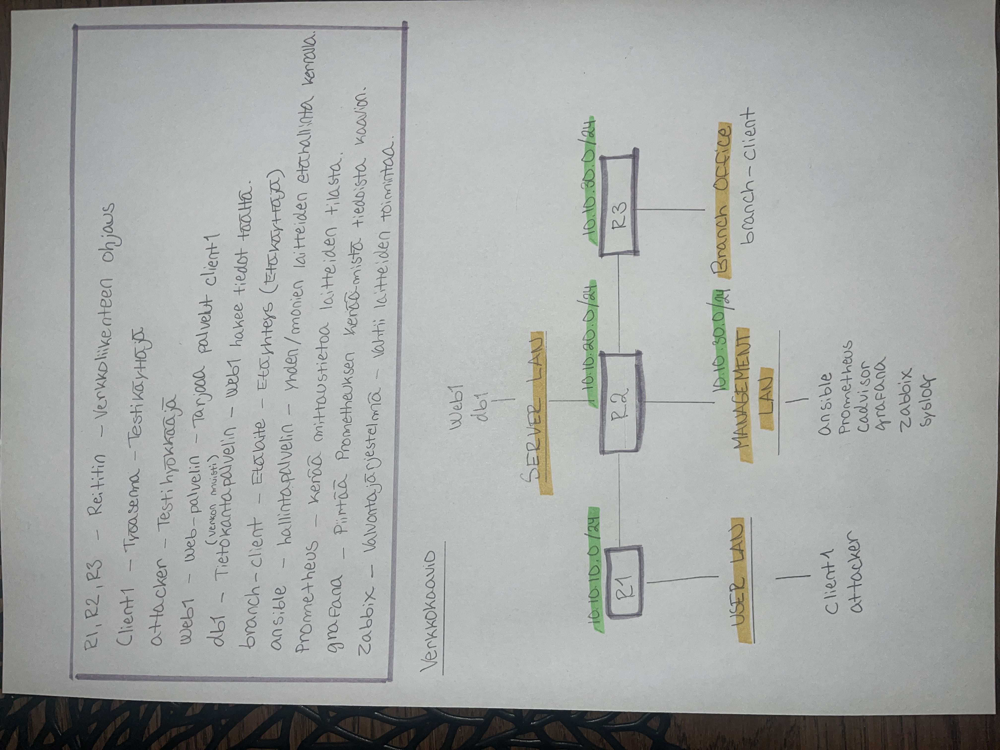
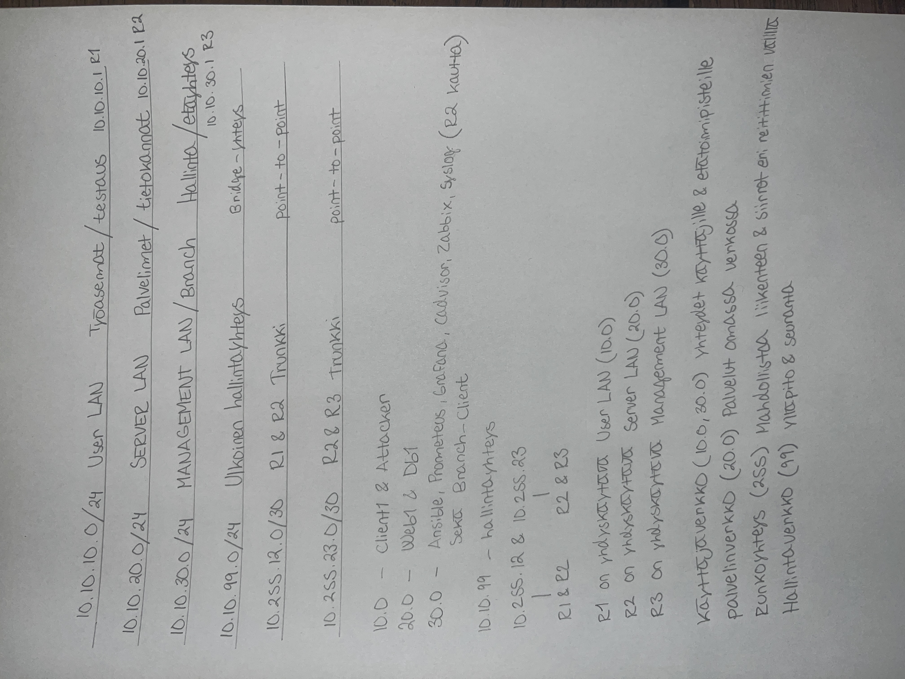

Verkonhallinta - Viikko 01 Raportti

1. Johdanto

Tässä ensimmäisessä harjoituksessa loimme Containerlab-ympäristöön verkon, johon kuuluu kolme reititintä ja erilaisia aliverkkoja. Tavoitteena oli hahmottaa, miten liikenne kulkee reitittimien välillä ja miten eri verkot, kuten käyttäjä-, palvelin- ja hallintaverkot, pidetään järjestyksessä.

2. Verkkokaavio

Verkon fyysinen rakenne on suunniteltu paperille (ks. liitekuva topology.png). Verkko koostuu kolmesta reitittimestä R1, R2, R3.

3. Laiteluettelo

Liitteenä

4. IP-suunnitelma

User LAN (10.10.10.0/24) Työasemat ja testaus 
Yhdyskäytävä R1 (10.10.10.1)

Server LAN (10.10.20.0/24) Palvelimet ja tietokannat Yhdyskäytävä R2 (10.10.20.1)

Management LAN / Branch (10.10.30.0/24) Hallinta ja etäyhteydet. Yhdyskäytävä R3 (10.10.30.1)

Ulkoinen hallintayhteys (10.10.99.0/24) Bridge-yhteys ylläpitoa ja seurantaa varten.

Runkoyhteydet
R1 <-> R2: 10.255.12.0/30
R2 <-> R3: 10.255.23.0/30

5. Reitityksen analyysi

Yhteyksiä testattiin client1-laitteelta käyttäen ping- ja traceroute-komentoja.

Ping-testi:
Yhteys hallintaverkon osoitteeseen 10.10.30.101 toimi onnistuneesti.

Traceroute-analyysi:
Liikenne kulkee seuraavaa reittiä:

10.10.10.1 (R1 - oletusyhdyskäytävä)
10.255.12.2 (R2 - välireititin)
10.255.23.2 (R3 - kohdeverkon reititin)
10.10.30.101 (Lopullinen kohde)

6. Yhteenveto

Pohdinta

Perehdyin aiheeseen syvemmin tekemällä paperille luonnoksia, jotta pystyin ymmärtämään verkon liikennettä paremmin.
Aikaa dokumentaatiossa vei se, että piti tutkia mihin verkkoon kukin laite kuuluu ja varmistaa, saavatko ne lopulta yhteyden.

Hyvä dokumentaatio nopeuttaa vianetsintää. Kun verkon rakenteen näkee yhdellä silmäyksellä, eikä jokaista laitetta tarvitsisi tutkia erikseen CLI:n kautta.

Tekoälyä käytetty siltä osin, että se auttoi komennoissa sekä vianetsinnässä kun ping ei lähtenyt toimimaan. 