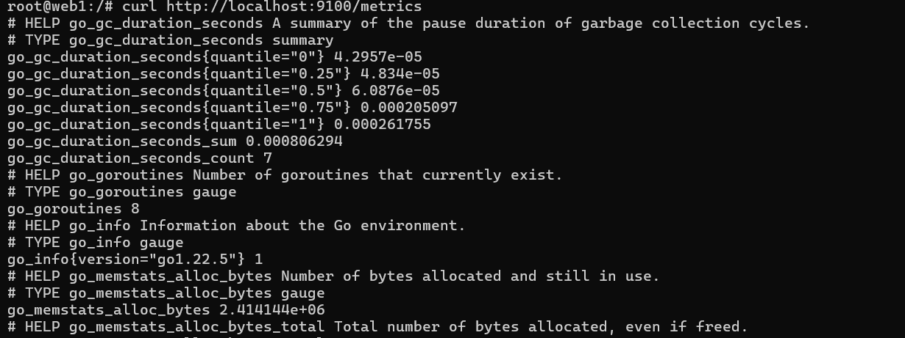
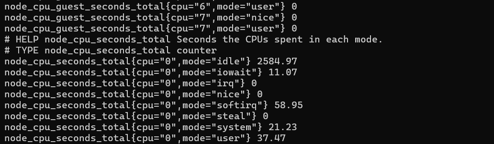
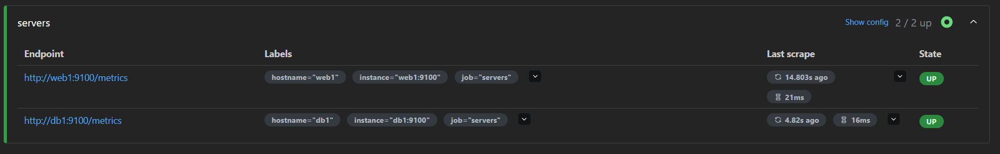
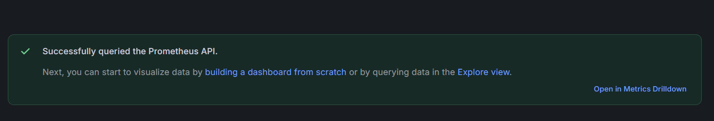
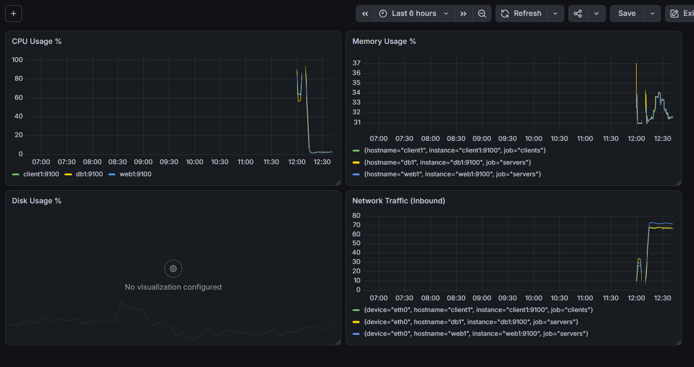
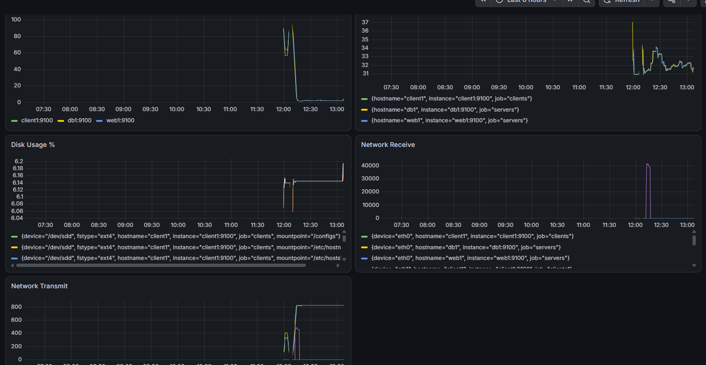

1. Johdanto

Tässä tehtävässä toteutettiin Containerlab-ympäristön monitorointi käyttämällä Prometheus- ja Grafana-työkaluja.Tavoitteena oli rakentaa järjestelmä, joka kerää reaaliaikaista tietoa verkon tilasta ja visualisoi sen grafiikaksi.

2. Node Exporterin käyttöönotto

Laitteiden valvontaa varten asensin web1-palvelimelle Node Exporter -agentin, joka kerää tietoa muun muassa prosessorin ja muistin tilasta. Latasin agentin ohjelmapaketin GitHubista, purin sen ja käynnistin palvelun toimimaan portissa 9100. Tämän asennuksen myötä palvelin alkoi tuottaa laitteistotason mittaustietoa, jota Grafana hyödyntää grafiikkana.

3. Prometheus

Tarkistin Prometheuksen tilan osoitteesta http://localhost:9090. Valitsin valikosta Status -> Targets

Kuvassa näkyy, että web1 ja db1 ovat tilassa UP. Tämä tarkoittaa, että Prometheus saa haettua tiedot onnistuneesti molemmilta palvelimilta.

4. Dashboard

Grafanaan luotiin dashboard nimeltä Golden Topology Monitoring. Monitorointinäkymään lisättiin seuraavat paneelit PromQL-kyselyillä:

CPU Usage %
Memory Usage %
Disk Usage %
Network Receive
Network Transmit

5. Kuormitustesti

Testasin järjestelmää aiheuttamalla kuormitusta web1-palvelimelle stress-ng ja dd -komennoilla.

Kuormitustestin aikana CPU-kuorma nousi selkeästi lähelle 100 % ja levytilan käyttö kasvoi testitiedoston luomisen myötä, mikä näkyi heti reaaliaikaisina piikkeinä Grafanassa.

6. SNMP vs Prometheus

| Ominaisuus | SNMP | Prometheus |
-----------------------------------------------
| Tiedonkeruu | Push/Pull (UDP) | Pull (HTTP) |
| Käyttöönotto | Valmiina laitteissa | Vaatii agentin |
| Mittarien määrä | Rajallinen | Erittäin laaja ja dynaaminen |
| Visualisointi | Erillinen työkalu | Grafana-integraatio vakiona |
| Hälytysmahdollisuudet | Traps | Alertmanager |
| Soveltuvuus pilviympäristöihin | Huono | Erinomainen |

7. Yhteenveto

Mitä hyötyä Prometheuksesta on verrattuna SNMP:hen?
Prometheus on helpompi tulkita ja se toimii paremmin nykyaikaisissa pilviympäristöissä. SNMP-tietoa on vaivalloisempaa ja hankalampaa hakea sen monimutkaisen rakenteen takia.

Millaisia mittareita ylläpitäjän kannattaa seurata jatkuvasti?
Koneiden muistin ja levytilan käyttöä on tärkeää seurata. Jos tila loppuu kesken, palvelimet voivat ylikuormittua tai lakata kokonaan toimimasta.

Mitä tietoa dashboardisi tarjoaa ylläpitäjälle?
Dashboard näyttää yhdellä silmäyksellä laitteiden reaaliaikaisen kuormituksen ja sen, kuinka paljon verkkoliikennettä liikkuu juuri nyt.

Mitä uusia mittareita lisäisit dashboardiin?
Lisäisin procs running -mittarin, koska siitä näkee heti, jos jokin sovellus alkaa luoda liikaa prosesseja tai jos käynnissä on palvelimen tukkiva DoS-hyökkäys.

Miten monitorointitiedosta voisi olla hyötyä vianetsinnässä?
Jos yhteys katkeaa, verkkoliikenteen grafiikka tippuu heti nollaan, ja siitä näkee suoraan tarkan kellonajan, milloin nettiyhteys meni poikki.
