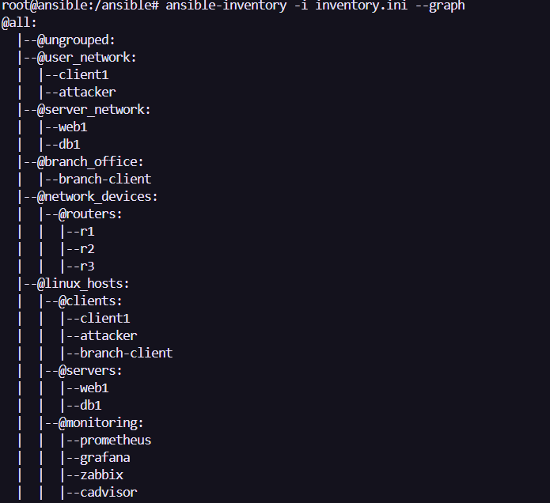
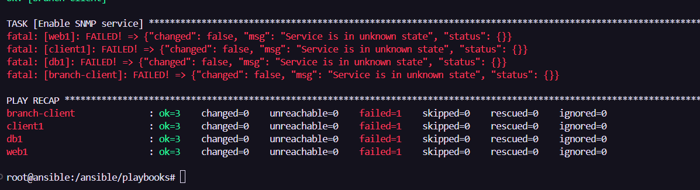
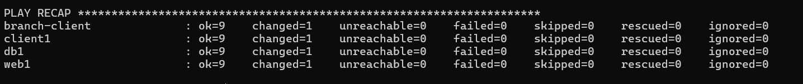
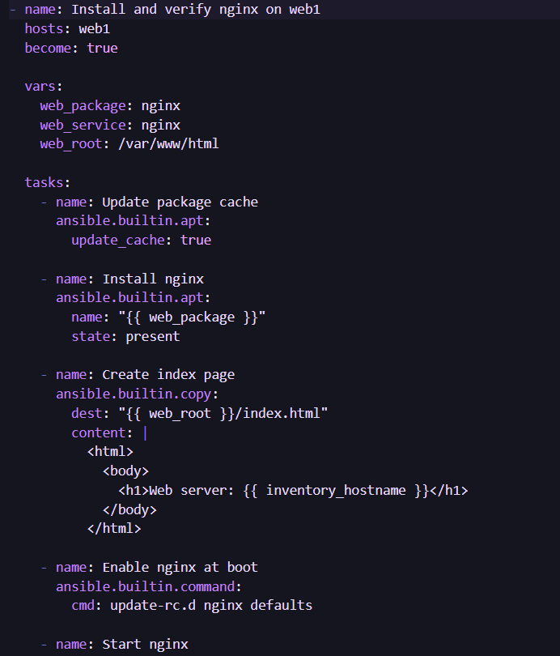
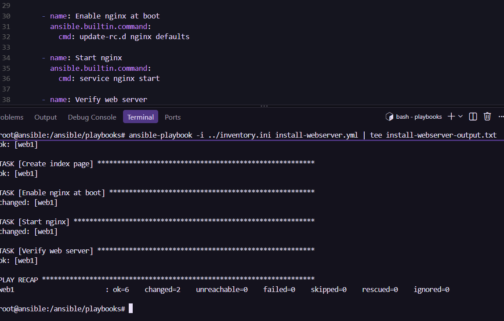

Johdanto

Infrastructure as Code tarkoittaa, että verkkoympäristöä voidaan hallita koodin avulla. Tehtäviä voidaan automatisoida ja tehdä usealla koneella yhtä aikaa. 

Inventory

Verkonhallinnan ympäristössä on kolme reititintä: r1, r2 ja r3. Asiakaskoneita ovat client1, attacker ja branch-client. Palvelimia ovat web1 ja db1. Valvontatyökaluja ovat prometheus, grafana, zabbix ja cadvisor.

Koneet on jaettu ryhmiin verkon, sijainnin ja käyttötarkoituksen mukaan. user_network-ryhmään kuuluvat client1 ja attacker, server_network-ryhmään web1 ja db1, ja branch_office-ryhmään branch-client.

Lisäksi network_devices-ryhmä sisältää routers-ryhmän, jossa ovat reitittimet r1, r2 ja r3. linux_hosts-ryhmän alla ovat clients-, servers- ja monitoring-ryhmät. Niissä ovat vastaavasti asiakaskoneet, palvelimet ja valvontatyökalut.

Ryhmittelyn avulla komentoja voi kohdistaa kerralla sopivaan ryhmään. Sama kone voi kuulua useaan ryhmään. Esimerkiksi client1 kuuluu sekä user_network ja clients-ryhmään.

Järjestelmätiedot (4.5)

Kone, käyttöjärjestelmä, ip-osoite, prosessori, muisti mb

client1 - Ubuntu - 172.20.20.4 - 8 - 7793
db1 - Ubuntu - 172.20.20.10 - 8	- 7793
attacker - Kali - 172.20.20.14 - 8 - 7793
web1 - Ubuntu - 172.20.20.6	- 8	- 7793
branch-client - Ubuntu - 172.20.20.3 - 8 - 7793
r1 - 172.20.20.15 - 8 7793 
r2 - 172.20.20.16 - 8 - 7793
r3 - 172.20.20.9 - 8 - 7793

Esimerkki playbook

SNMP-playbook asentaa tarvittavat paketit ja tekee asetustiedoston. Jos asetustiedosto muuttuu, playbook käynnistää SNMP-palvelun uudelleen. Palvelun käynnistäminen ei kuitenkaan onnistunut neljällä koneella, vaan tuli virhe “Service is in unknown state”.

Node Exporter -playbook lataa ja asentaa ohjelman. Node_exporter_version muuttuja kertoo, mikä versio asennetaan. Playbook käynnistää ohjelman ja tarkistaa, että /metrics-osoite toimii. Handleria ei tarvita, koska ohjelma käynnistetään suoraan playbookin tehtävässä.

 SNMP
 Node Exporter

Oma playbook

Tein playbookin, joka asentaa nginxin web1-koneelle ja tarkistaa, että verkkopalvelin vastaa. Playbookin tehtäviin kuuluvat aloitussivun luominen, nginxin käyttöönotto käynnistyksen yhteydessä ja palvelun käynnistäminen. Ajo onnistui: tulosteessa näkyi ok=6, changed=2, unreachable=0 ja failed=0

Vertailu

Kun ohjelmia asennetaan käsin, samat komennot pitää tehdä jokaisella koneella erikseen. Jos asennus tehdään vain kerran pienelle määrälle koneita, se onnistuu hyvin käsinkin. Jos koneita on paljon tai sama asennus pitää tehdä usein, siihen kuluu enemmän aikaa. Ansiblella asennus kirjoitetaan playbookiin, jonka voi ajaa samalla tavalla usealle koneelle.

Yhteenveto

Tutustuin Ansible-inventoryyn ja playbookeihin. Keräsin koneista järjestelmätietoja ja kokeilin nginxin asentamista web1-koneelle. Opin, että Ansiblella tehtäviä voi automatisoida ja ajaa samalla tavalla usealla koneella. 

Huomio teköälyn käytöstä snmp sekä komentojen yhteydessä.