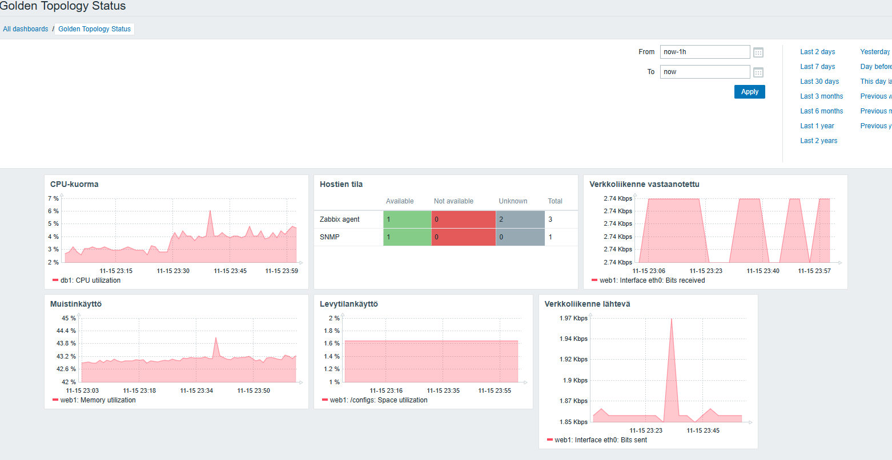
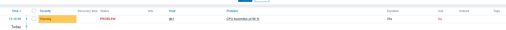

Verkonhallinta - Viikko 06 Raportti

Zabbix

Johdanto

Tässä tehtävässä tutustuin Zabbix-valvontajärjestelmään. Zabbix on ohjelma, jolla seurataan tietokoneiden ja palvelimien toimintaa. Sen avulla näkee, ovatko laitteet toiminnassa ja kerääntyvätkö niistä tiedot oikein.

Hosts = Valvottavat laitteet ja palvelimet.
Templates = Hosteihin liitettävät valvontamallit.
Monitoring = Valvontatietojen ja ongelmien seuranta.
Dashboards = Kaikki tiedot yhdessä näkymässä.
Alerts = Ilmoitukset havaitusta ongelmista.
Reports = Koosteita valvontatiedoista.

Hostin lisääminen

Lisäsin Zabbixiin valvottavat laitteet eli hostit. db1-palvelimelle liitin SNMPv2-mallit ja tarkistin, että mittareita alkoi saapua. Seurasin suorittimen käyttöä, muistia, käynnissäoloaikaa ja verkkoliikennettä. web1-palvelimen tietoja seurattiin Zabbix-agentin avulla.

Dashboard

Rakensin Zabbixiin Golden Topology Status -dashboardin, jossa näkyvät palvelinten CPU-, muisti-, levytila- ja verkkoliikennetiedot. Mittareiden näkyminen kuvaajissa edellytti niiden toiminnan tarkistamista ja tarvittaessa käyttöönottoa erikseen. Tämän rakentaminen tuntui työläältä, koska kaikki mittarit eivät päivittyneet normaalisti

Mittarit

Valvontamittarien analyysi

CPU utilization	2,6525 %	Kuinka suuri osa suorittimen kapasiteetista on käytössä.	Korkea arvo voi kertoa siitä, että palvelin on kovassa kuormassa.
CPU idle time	97,3475 %	Kuinka suuren osan ajasta suoritin on vapaana.	Matala arvo voi kertoa jatkuvasta suuresta kuormituksesta.
Load average (1m avg)	0,1436	Palvelimen keskimääräinen kuormitus viimeisen minuutin aikana.	Sen avulla voi huomata lyhyet kuormituksen muutokset.
Load average (5m avg)	0,2271	Palvelimen keskimääräinen kuormitus viimeisen viiden minuutin aikana.	Se auttaa näkemään, jatkuuko kuormitus useamman minuutin ajan.
Load average (15m avg)	0,1812	Palvelimen keskimääräinen kuormitus viimeisen 15 minuutin aikana.	Se auttaa seuraamaan pidemmän ajan kuormitusta.

Triggerit

CPU-kuormitus yli 80 % — {db1:system.cpu.util.min(5m)}>80 — Warning

Levytilaa alle 20 % — {web1:vfs.fs.size[/configs,pused].min(5m)}>80 — Warning

Hälytys- ja häiriötestit

Hälytyksen simulointi 6.8

Alkuperäinen CPU-ehto (>80 % viiden minuutin ajan) ei lauennut ensimmäisessä testissä. Muutin ehtoa testin ajaksi (>70 % minuutin ajan), minkä jälkeen db1-hostille syntyi Warning-hälytys. Ensimmäisessä kuvakaappauksessa hälytys oli ollut aktiivisena 25 sekuntia. Palautin ehdon testin jälkeen alkuperäiseksi.
Kun pysäytin testikuorman, hälytys palautui Resolved-tilaan.

Häiriötilanne 6.9

Yritin testata hälytystä pysäyttämällä web1-kontin, koska harjoituksessa mainittuja palveluita ei löytynyt. Zabbixin Problems-näkymään ei tullut uutta hälytystä. Käynnistin kontin uudelleen, ja sen tila palautui normaaliksi.

Vertailu

Kurssin työkalujen vertailu

SNMP: Tiedonkeruu: kerää tietoja esimerkiksi reitittimistä ja kytkimistä. Dashboardit: tarvitsee yleensä toisen ohjelman tietojen näyttämiseen. Hälytykset: laitteet voivat lähettää häiriöilmoituksia, mutta niiden käsittelyyn tarvitaan valvontaohjelma. Käyttöönotto: SNMP otetaan käyttöön laitteissa ja yhdistetään valvontaohjelmaan. Skaalautuvuus: sopii monien verkkolaitteiden valvontaan, mutta laajuus riippuu valvontaohjelmasta. Yrityskäyttö: käytetään paljon yritysten verkkolaitteiden valvontaan.

Prometheus: Tiedonkeruu: kerää mittareita sovelluksista ja palvelimista. Dashboardit: tietoja voi tarkastella Prometheuksessa, mutta usein käytetään Grafanaa. Hälytykset: voi havaita ongelmia ja lähettää niistä ilmoituksia. Käyttöönotto: Prometheus asennetaan ja sille määritetään valvottavat kohteet. Skaalautuvuus: sopii suuriinkin ympäristöihin, mutta voi tarvita lisäosia. Yrityskäyttö: sopii erityisesti sovellusten, pilvipalvelujen ja konttien valvontaan.

Zabbix: Tiedonkeruu: kerää tietoja esimerkiksi palvelimista ja verkkolaitteista. Dashboardit: sisältää omat näkymät tietojen tarkasteluun. Hälytykset: voi ilmoittaa havaituista ongelmista. Käyttöönotto: Zabbix asennetaan ja valvottavat kohteet lisätään siihen. Skaalautuvuus: sopii suuriinkin ympäristöihin. Yrityskäyttö: sopii yritysten palvelimien, verkkolaitteiden ja palvelujen valvontaan.

Yhteenveto

Mitä hyötyä keskitetystä valvonnasta on?
Keskitetty valvonta näyttää laitteiden ja palvelujen tilan yhdessä paikassa ja helpottaa häiriöiden löytämistä.

Mitkä mittarit ovat mielestäsi tärkeimpiä?
Tärkeimpiä mittareita ovat palvelujen toimivuus, suorittimen, muistin ja levytilan käyttö.
 
Millaisista tilanteista ylläpitäjän pitäisi saada hälytys?
Hälytys pitäisi saada esimerkiksi palvelun pysähtymisestä, levytilan loppumisesta, hitaudesta tai pitkään jatkuvasta suuresta kuormituksesta.

Missä tilanteissa käyttäisit Prometheusta?
Käyttäisin Prometheusta sovellusten, konttien ja pilvipalvelujen mittareiden seuraamiseen.

Missä tilanteissa käyttäisit Zabbixia?
Käyttäisin Zabbixia palvelimien, verkkolaitteiden ja palvelujen valvontaan.

Mitä valvontatoimintoja lisäisit tähän ympäristöön?
Lisäisin palvelujen saatavuuden ja vasteajan seurannan sekä hälytykset poikkeamista.

Tehtävässä oli paljon uusia asioita, ja mittareiden toimintaa piti tarkistaa sekä tarvittaessa korjata, jotta Zabbix näytti ajantasaisia tietoja. Opin kuitenkin, miten Zabbix toimii ja millaisia tietoja sen avulla voidaan kerätä ja esittää. Harjoittelin laitteiden lisäämistä Zabbixiin, valmiiden mallien eli templatejen hyödyntämistä sekä mittareiden keräämistä palvelimilta. Rakensin dashboardeja, loin ja testasin trigger-hälytyksiä sekä harjoittelin poikkeavien tilanteiden tunnistamista. Käytin tekoälyä apuna ongelmatilanteissa, kun mittarit eivät päivittyneet tai toimineet odotetusti. Tehtävä auttoi ymmärtämään, miten valvontajärjestelmää voidaan hyödyntää laitteiden ja palveluiden toiminnan seuraamisessa.